# 🛡️ Awesome-Cloud-Backup-Rest-API-Gateway 🚀

<div align="center">



<br/>

<a href="https://github.com/ishandutta2007/Awesome-Awesome-Awesome"></a><a href="https://discord.gg/jc4xtF58Ve"></a>
[](https://opensource.org/licenses/MIT)
[](https://github.com/ishandutta2007/Awesome-Cloud-Backup-Rest-API-Gateway/pulls)
[](https://github.com/ishandutta2007/Awesome-Cloud-Backup-Rest-API-Gateway/graphs/commit-activity)
[](https://github.com/ishandutta2007/Awesome-Cloud-Backup-Rest-API-Gateway)
<a href="https://github.com/ishandutta2007"></a>

<p align="center">
  <b>A comprehensive, SEO-optimized curated directory of enterprise SaaS solutions and open-source API gateways for cloud backup automation, REST API routing, rate limiting, and multi-tenant resilient data protection pipelines.</b>
</p>

</div>

---

## 📌 Executive Summary & Key Highlights

This repository serves as a curated catalog tracking the **Cloud Backup REST API Gateway** ecosystem. In modern disaster recovery, backup automation, and cloud storage architectures, API Gateways act as the central control plane—enforcing **OAuth 2.0 / zero-trust token authentication**, **per-tenant request throttling & rate limiting**, **dynamic payload routing**, **observability & audit logging**, and **usage-based metering** for backup and data resilience engines (such as Druva, Veeam, Commvault, Rubrik, AWS Backup, and custom S3-compatible snapshot stores).

Whether you are architecting a private multi-cloud enterprise backup portal, orchestrating Kubernetes storage snapshot endpoints, or looking for high-throughput, vendor-neutral reverse proxies to eliminate egress surprise costs, this guide benchmarks the leading hosted SaaS suites and self-hosted open-source software (OSS).

---

## 📑 Table of Contents
- [📊 Sector Overview & Market Dynamics](#-sector-overview--market-dynamics)
- [☁️ SaaS / Hosted Gateway Platforms](#️-saas--hosted-gateway-platforms)
- [⚡ Open-Source API Gateways & Proxies (Ranked by Stars)](#-open-source-api-gateways--proxies-ranked-by-stars)
- [🛠️ Architectural Design Patterns for Backup Gateways](#️-architectural-design-patterns-for-backup-gateways)
- [🤝 How to Contribute](#-how-to-contribute)
- [💖 Support & Sponsorship](#-support--sponsorship)
- [📈 Star History](#-star-history)
- [⚖️ Disclaimer & Security Advisory](#️-disclaimer--security-advisory)

---

## 📊 Sector Overview & Market Dynamics

The global API management and gateway sector is estimated at **$8.6B to $13.5B in 2026** (expanding at an aggressive ~16–28% CAGR), propelled by cloud-native microservices architectures, hybrid cloud disaster recovery compliance, enterprise data governance, and explosive growth in AI agent backup traffic. 

The market exhibits a **moderately fragmented** structure characterized by a dual-tier competitive landscape:
1. **Tier 1 (Enterprise Hyperscalers):** Heavy concentration among cloud giants (**Microsoft Azure**, **Alphabet / Google Cloud Apigee**, **Amazon Web Services**) and enterprise SaaS heavyweights (**Salesforce / MuleSoft**), which bundle gateways directly into enterprise cloud agreements.
2. **Tier 2 (Open-Core & Cloud-Native Innovators):** High fragmentation fueled by community-backed open-core platforms (**Kong**, **Traefik Labs**, **Tyk**, **Gravitee.io**, **WSO2**, **KrakenD**) that deliver specialized Kubernetes ingress, sub-millisecond edge latency, self-hosted data residency compliance, and avoidance of per-request cloud billing surcharges.

---

## ☁️ SaaS / Hosted Gateway Platforms

*Enterprise-grade cloud-hosted API management platforms sorted in descending order of parent company market capitalization and corporate revenue run-rate.*

| Product | Company Valuation / Revenue | Description | Pricing (Starting) | Free Tier / Trial Limits |
|:---|:---:|:---|:---|:---|
| **[Azure API Management](https://azure.microsoft.com/en-us/products/api-management/)** | ~$4.04T *(Microsoft Market Cap)* | Microsoft's enterprise API gateway supporting hybrid and multi-cloud API orchestration. | Consumption tier: ~$3.50/million calls (after free grant); Developer tier from $48.04/month | **Consumption tier**: 1M API calls/month free forever; 1 active service unit |
| **[Apigee (Google Cloud)](https://cloud.google.com/apigee)** | ~$3.53T *(Alphabet Market Cap)* | Enterprise API management with gateway, analytics, developer portal, and policy governance. | Pay-as-you-go: $0.50/hour per base environment (~$365/month) + $20/million standard API calls | **60-day free evaluation**: 1 instance, 2 environments, capped at non-production evaluation workloads |
| **[AWS API Gateway](https://aws.amazon.com/api-gateway/)** | ~$2.93T *(Amazon Market Cap)* | Fully managed gateway for REST, HTTP, and WebSocket APIs with direct AWS service integrations. | HTTP API: $1.00/million calls; REST API: $3.50/million calls | **AWS Free Tier (12 months)**: 1M REST calls + 1M HTTP calls + 1M WebSocket messages + 750K connection minutes/month |
| **[MuleSoft Anypoint](https://www.mulesoft.com/)** | ~$186B *(Salesforce Market Cap)* | Enterprise integration platform as a service (iPaaS) and full lifecycle API management suite. | Anypoint Starter from $2,000/month ($24,000 billed annually) based on Mule credit consumption | **30-day free trial**: Access to CloudHub, Design Center, and Exchange; 1 virtual core (vCore) max, no credit card required |
| **[Kong Gateway (Konnect)](https://konghq.com/)** | $2.0B Valuation *($100M+ ARR)* | Cloud-native API gateway and service connectivity platform built on OpenResty/Envoy. | Konnect Serverless from $25/month (includes 1M API requests); Dedicated Cloud Gateway from $500/month | **30-day free trial**: Full Enterprise functionality, unlimited Gateway instances, analytics retained 30 days |
| **[Druva API Gateway](https://developer.druva.com)** | $2.0B Valuation *($200M+ ARR)* | Dedicated REST API layer for Druva's Data Resiliency Cloud, exposing backup, retention, and MSP APIs. | Starts at ~$7–$10/user/month (Endpoint) or ~$200/TB/month (Server Workloads, volume-tiered) | **30-day free trial**: Full access to Data Resiliency Cloud APIs, capped at 100 endpoints or 5 TB backup storage |
| **[WSO2 API Manager](https://wso2.com/api-manager/)** | $600M Valuation *(~$130M ARR)* | Open-source-driven API management and governance platform with SaaS and self-hosted editions. | Pay-As-You-Go SaaS from $119/month (includes 10 managed API interfaces and 10M monthly gateway events) | **30-day free trial**: 5 managed API interfaces, 1M gateway events, 1 hybrid gateway, and hosted developer portal |
| **[Gravitee.io](https://www.gravitee.io/)** | $300M+ Valuation *($30M ARR)* | API management and security platform supporting synchronous (REST/GraphQL) and event-driven (Kafka/MQTT) APIs. | Planet Cloud tier from $2,500/month (1 production gateway); Community Edition OSS is $0 | **Community Edition**: Free forever (Apache 2.0, unlimited gateways); **Gravitee Cloud 14-day free trial** with full enterprise features |
| **[Tyk](https://tyk.io/)** | ~$18M ARR *(Private)* | High-performance open-source API gateway and management platform supporting REST, GraphQL, and MCP. | Tyk Cloud Starter historically from $600/month (~10M calls); Self-Managed OSS Gateway is $0 | **Tyk Gateway OSS**: Free forever (MPL 2.0, unlimited scale); **Tyk Enterprise 14-day free trial** license on request |
| **[Traefik Hub](https://traefik.io/)** | ~$3M ARR / $11.2M Funding *(Private)* | Kubernetes-native API gateway and management platform built on the open-source Traefik Proxy engine. | Traefik Hub Team from $99/month; Traefik Proxy OSS is $0 (MIT) | **Traefik Proxy OSS**: Free forever (MIT, unlimited scale); **Traefik Hub 30-day free trial** for API Gateway commercial tier |

---

## ⚡ Open-Source API Gateways & Proxies (Ranked by Stars)

*Self-hosted, transparent, and battle-tested open-source API gateways and reverse proxies. Sorted in **descending order by GitHub stargazers count**.*

| Project | GitHub_Stars | License | Primary Tech Stack | Description |
|:---|:---:|:---:|:---:|:---|
| **[Caddy](https://github.com/caddyserver/caddy)** | [](https://github.com/caddyserver/caddy/stargazers) | Apache-2.0 | Go | Powerful, enterprise-ready, open source web server with automatic HTTPS and reverse proxying capabilities, ideal for simple SSL-terminating backup endpoints. |
| **[Traefik Proxy](https://github.com/traefik/traefik)** | [](https://github.com/traefik/traefik/stargazers) | MIT | Go | Modern HTTP reverse proxy and load balancer that makes deploying microservices easy. Natively integrates with Docker, Swarm, Kubernetes, and Consul to auto-discover backup services. |
| **[Kong Gateway (OSS)](https://github.com/Kong/kong)** | [](https://github.com/Kong/kong/stargazers) | Apache-2.0 | Lua / OpenResty | The world’s most popular open-source API gateway. Provides plug-and-play middleware for authentication, JWT validation, rate limiting, ACLs, and request transformation. |
| **[NGINX](https://github.com/nginx/nginx)** | [](https://github.com/nginx/nginx/stargazers) | 2-clause BSD | C | High-performance HTTP and reverse proxy server powering the core dataplane of numerous API gateways and large-scale media backup pipelines globally. |
| **[Envoy Proxy](https://github.com/envoyproxy/envoy)** | [](https://github.com/envoyproxy/envoy/stargazers) | Apache-2.0 | C++ | CNCF graduated high-performance cloud-native edge and service proxy. Delivers dynamic configuration (xDS APIs), advanced load balancing, and observability. |
| **[Apache APISIX](https://github.com/apache/apisix)** | [](https://github.com/apache/apisix/stargazers) | Apache-2.0 | Lua / NGINX / etcd | Ultra-high-performance dynamic API gateway providing rich traffic management features such as load balancing, dynamic upstream routing, canary releases, and health checks. |
| **[Netflix Zuul](https://github.com/Netflix/zuul)** | [](https://github.com/Netflix/zuul/stargazers) | Apache-2.0 | Java | Battle-tested edge gateway service that provides dynamic routing, monitoring, resiliency, and security for high-volume enterprise microservices architectures. |
| **[Tyk Gateway](https://github.com/TykTechnologies/tyk)** | [](https://github.com/TykTechnologies/tyk/stargazers) | MPL-2.0 | Go | Lightweight, fast open-source HTTP/REST/GraphQL API gateway. Features distributed rate limiting, quota controls, key management, and zero third-party dependencies. |
| **[Apache Camel](https://github.com/apache/camel)** | [](https://github.com/apache/camel/stargazers) | Apache-2.0 | Java | Versatile integration framework based on Enterprise Integration Patterns (EIPs). Features 300+ connectors to bridge REST APIs with backup storage systems (S3, Azure Blob, Kafka). |
| **[Envoy Gateway](https://github.com/envoyproxy/gateway)** | [](https://github.com/envoyproxy/gateway/stargazers) | Apache-2.0 | Go | Official CNCF project managing Envoy Proxy as a standalone or Kubernetes Gateway API implementation, simplifying cloud-native backup ingress traffic. |
| **[KrakenD-CE](https://github.com/krakend/krakend-ce)** | [](https://github.com/krakend/krakend-ce/stargazers) | Apache-2.0 | Go | Ultra-performant, stateless API gateway that aggregates multiple backend services into single endpoints without writing backend glue code. |
| **[WSO2 API Manager](https://github.com/wso2/product-apim)** | [](https://github.com/wso2/product-apim/stargazers) | Apache-2.0 | Java | Complete, 100% open-source enterprise API management solution supporting API design, token security, lifecycle management, analytics, and self-service portals. |
| **[Gravitee API Management](https://github.com/gravitee-io/gravitee-api-management)** | [](https://github.com/gravitee-io/gravitee-api-management/stargazers) | Apache-2.0 | Java | Flexible open-core API management platform governing REST, SOAP, and real-time event-driven streaming protocols (Kafka, MQTT, WebSockets). |

---

## 🛠️ Architectural Design Patterns for Backup Gateways

When deploying an API Gateway in front of data protection and cloud backup backends, consider three foundational architectural patterns:

```
                      ┌────────────────────────────────────────┐
                      │    Client / Backup Agent / Workload    │
                      └───────────────────┬────────────────────┘
                                          │ HTTPS (REST API)
                                          ▼
                      ┌────────────────────────────────────────┐
                      │    Cloud Backup REST API Gateway       │
                      │  - OAuth 2.0 / mTLS Authentication     │
                      │  - Tenant Rate Limiting & Quotas       │
                      │  - Request Transformation & Routing    │
                      │  - Audit Logging & Egress Metering     │
                      └───────┬────────────────────────┬───────┘
                              │                        │
            ┌─────────────────▼────────┐      ┌────────▼─────────────────┐
            │ SaaS Backup API Service  │      │ Self-Hosted Storage / S3 │
            │ (Druva, Veeam, Apigee)   │      │ (MinIO, Ceph, Snapshot)  │
            └──────────────────────────┘      └──────────────────────────┘
```

1. **Zero-Trust Multi-Tenant Isolation**: Implement strict JWT/OAuth token verification and mutual TLS (mTLS) at the gateway layer to guarantee that snapshot, legal hold, and disaster recovery endpoints are protected against unauthorized calls.
2. **Dynamic Request Throttling**: Configure token-bucket rate limiting to prevent concurrent backup jobs from choking internal storage networks and incurring high API burst billing.
3. **Hybrid API Façade**: Bridge legacy file/tape backup systems with modern S3-compatible cloud storage using integration engines like **Apache Camel** paired with **Kong OSS** or **Traefik**.

---

## 🤝 How to Contribute

Contributions are what make the open-source community an incredible place to learn, inspire, and create! 

1. **Fork** the Repository 🍴
2. **Create your Feature Branch** (`git checkout -b feature/NewBackupGateway`)
3. **Commit your Changes** (`git commit -m 'Add new open-source backup gateway entry'`)
4. **Push to the Branch** (`git push origin feature/NewBackupGateway`)
5. **Open a Pull Request** 🚀

> 💡 *Please adhere to the table formatting, provide accurate licensing/tech stack details, and cite official documentation.*

---

## 💖 Support & Sponsorship

If this curated repository saved you hours of architectural research or helped you optimize your enterprise cloud backup pipeline, please consider supporting the project:

- ⭐ **Star this repository** to increase visibility across the community!
- 🍴 **Fork and share** with fellow DevOps, SREs, and Platform Engineers.
- ☕ **Buy me a coffee**: Support ongoing maintenance via the [GitHub Sponsors Dashboard](https://github.com/sponsors/ishandutta2007).

Your support keeps this knowledge hub up-to-date and continuously expanding! 🌟

---

## 📈 Star History

[](https://www.star-history.com/#ishandutta2007/Awesome-Cloud-Backup-Rest-API-Gateway&type=date&legend=top-left)

---

## ⚖️ Disclaimer & Security Advisory

- This repository is an independent, **community-curated directory** intended for educational and architectural evaluation purposes. Mention of specific vendors does not constitute an endorsement.
- All API gateways handling sensitive backup and disaster recovery data must enforce strict authentication (OAuth 2.0, token-based verification), per-tenant quotas, encryption-in-transit (TLS 1.3), and tamper-evident audit logging.
- Pricing metrics, trial tiers, and licensing models are accurate as of March 2026 and subject to change by respective vendor organizations.

---

<div align="center">
  <b>Made with ❤️ for platform engineers, backup administrators, API architects, and cloud developers.</b>
</div>
